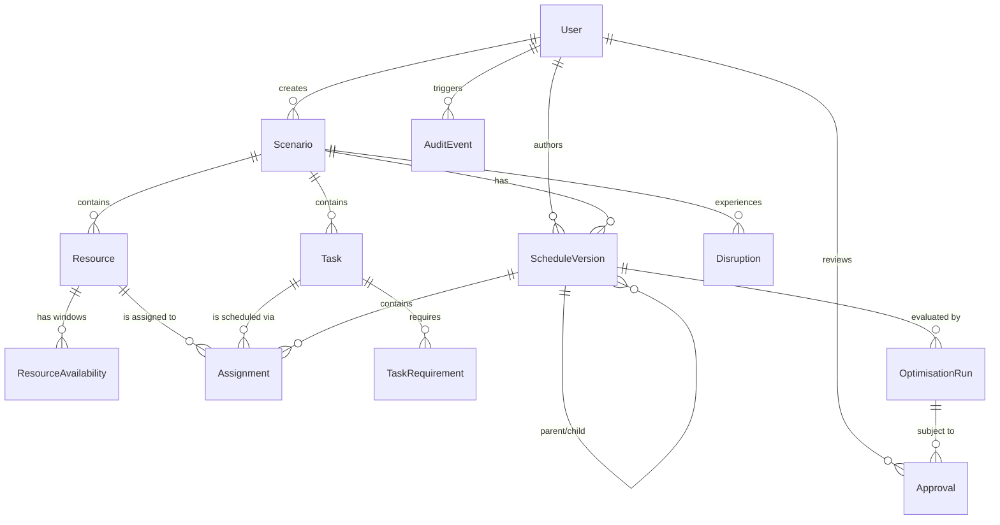

# Secure AI-Assisted Scheduling and Dynamic Rescheduling Decision-Support System (PS 26250)
## System Architecture Document (ARCHITECTURE.md)

---

### 1. Executive Summary & Problem Scope

In modern complex operational planning (e.g., humanitarian airlift, supply chain coordination, medical evacuation, and air-ground logistics), schedules involve heterogeneous resources (aircraft, crew, maintenance bays, handling equipment), strict operational time windows, qualification requirements, maintenance intervals, and hard turnaround constraints.

Unforeseen disruptions—such as sudden technical snags, weather-induced airport closures, urgent priority task injections, or crew duty-time expirations—frequently invalidate baseline schedules. Decision-makers often face information fragmentation, leading to cascading delays, safety violations, or suboptimal manual re-allocations.

**AirOps Scheduler (PS 26250)** is an educational and enterprise decision-support prototype engineered to:
1. Maintain unified state representations across resources, tasks, constraints, and time horizons.
2. Generate conflict-free, mathematically verified baseline schedules.
3. Simulate stochastic and deterministic disruptions using synthetic scenarios.
4. Provide independent, multi-rule conflict detection with explainability.
5. Solve dynamic rescheduling using Google OR-Tools CP-SAT (Constraint Programming with Satisfiability).
6. Enable side-by-side comparative analysis (KPI deviations, resource churn, flight/transit delay).
7. Enforce strict Role-Based Access Control (RBAC), immutable versioning, and auditable human-in-the-loop review.

> **Operational & Safety Boundary:**
> This software is strictly an educational and decision-support prototype. It operates entirely on generic, fictional, and synthetic data. It contains **no** connections to classified operational feeds, military networks, tactical systems, weapon deployment controls, or live targeting systems.

---

### 2. High-Level Logical Architecture

The system follows a clean, modular monolith design pattern ensuring high cohesion, strong domain encapsulation, zero unnecessary distributed system overhead, and straightforward local/container deployment.

```
+---------------------------------------------------------------------------------------+
|                                    USER INTERFACE                                     |
|               (React 18 + TypeScript + Vite + Tailwind CSS + Lucide Icons)            |
|                                                                                       |
|  +--------------------+  +----------------------+  +-------------------------------+  |
|  |  Dashboard / KPIs  |  |  Scenario & Entities |  |  Interactive Gantt Timeline   |  |
|  +--------------------+  +----------------------+  +-------------------------------+  |
|  | Disruption Studio  |  |  Solver Comparison   |  |  Review & Audit Ledger Logs   |  |
|  +--------------------+  +----------------------+  +-------------------------------+  |
+-------------------------------------------|-------------------------------------------+
                                            | HTTPS / REST JSON (OpenAPI v3)
                                            v
+---------------------------------------------------------------------------------------+
|                           FASTAPI APPLICATION LAYER (Python 3.11+)                    |
|                                                                                       |
|  +---------------------------------------------------------------------------------+  |
|  | Security & Auth Middleware (JWT Bearer, Argon2 / Bcrypt, RBAC Gatekeeper)       |  |
|  +---------------------------------------------------------------------------------+  |
|  | Routers: /auth, /scenarios, /resources, /tasks, /schedules, /disruptions,       |  |
|  |          /optimisation, /approvals, /reports, /audit                            |  |
|  +---------------------------------------------------------------------------------+  |
|                                           |                                           |
|                                           v                                           |
|  +---------------------------------------------------------------------------------+  |
|  | DOMAIN SERVICES LAYER                                                           |  |
|  | - ScenarioService       - ScheduleService          - DisruptionService          |  |
|  | - ConflictDetector      - ApprovalService          - AuditLogger                |  |
|  +---------------------------------------------------------------------------------+  |
|         |                                 |                                |          |
|         v                                 v                                v          |
|  +---------------------+        +--------------------+        +--------------------+  |
|  | OPTIMISATION ENGINE |        | REPOSITORIES LAYER |        | ADVISORY AI / JEPA |  |
|  | - OR-Tools CP-SAT   |        | - CRUD & Queries   |        | - Structured Fact  |  |
|  | - Multi-Obj Weights |        | - Unit of Work / TX|        |   Explanations     |  |
|  | - Infeasibility Expl|        | - Immutable Diffs  |        | - Rule-based AI    |  |
|  +---------------------+        +--------------------+        +--------------------+  |
+-------------------------------------------|-------------------------------------------+
                                            | SQLAlchemy 2.0 Async/Sync ORM
                                            v
+---------------------------------------------------------------------------------------+
|                             PERSISTENCE & AUDIT (PostgreSQL 15+)                      |
|                                                                                       |
|  - Users & Roles            - Scenarios & Entities      - Immutable Schedule Versions |
|  - Task Allocations         - Synthetic Disruptions     - Optimisation Runs & Proofs  |
|  - Cryptographic / Append-Only Audit Event Ledger                                     |
+---------------------------------------------------------------------------------------+
```

---

### 3. Component Responsibilities & Layering

1. **Presentation Layer (Frontend)**:
   - Single Page Application (SPA) built with React 18, TypeScript, Vite, Tailwind CSS.
   - Global server state handled by **TanStack Query (React Query)** with caching and automatic re-fetching on mutations.
   - Form handling and client-side validation via **React Hook Form** + **Zod**.
   - Custom SVG-based and CSS Grid Gantt timeline component depicting resources vs. temporal horizon, distinguishing baseline, disruption conflicts, and proposed revisions.
   - Visual comparison mode highlighting task shifting, resource reassignment, and slack utilization.

2. **API & Security Gateway (FastAPI)**:
   - Pydantic v2 schemas for strict input deserialization, normalization, and output masking (preventing internal ORM leakage).
   - OAuth2 Password Bearer flow issuing scoped JSON Web Tokens (JWT).
   - Dependency-injected RBAC authorizing actions based on four roles: `ADMIN`, `PLANNER`, `REVIEWER`, `VIEWER`.
   - Comprehensive error handling returning standardized RFC 7807 problem details.

3. **Core Services**:
   - `ScenarioService`: Manages simulation sandboxes, cloning, and deterministic synthetic generation.
   - `ScheduleService`: Orchestrates schedule version trees (Parent-Child DAG), ensuring approved versions are locked as immutable.
   - `DisruptionService`: Applies synthetic operational events (e.g., resource grounded, maintenance window extended, task duration surge).
   - `ConflictService` (**Independent Validator**): A non-solver pure-Python deterministic verification engine that independently validates 100% of CP-SAT proposals across 6 distinct constraint categories.
   - `OptimisationService`: Formulates constraint satisfaction models and dispatches jobs to the OR-Tools CP-SAT solver.
   - `AuditService`: Ingests every state mutation into an immutable `AuditEvent` ledger with user context, entity diffs, and IP/timestamp metadata.

4. **Optimisation Engine (OR-Tools CP-SAT)**:
   - Discretized operational time horizon (integer minutes or 5-minute epochs).
   - Dual-variable formulation: Interval variables `NewIntervalVar(start, duration, end, is_present)` and boolean assignment indicators `NewBoolVar(task_resource_pair)`.
   - Hard constraints: `AddNoOverlap` per single-capacity resource, cumulative capacity limits, qualification matrix enforcement, and temporal windows `[earliest_start, latest_finish]`.
   - Objective function: Multi-criteria weighted minimization penalizing unassigned tasks, schedule delays, resource switching churn, and total makespan.

5. **Advisory AI & Explanation Module**:
   - Implements `ExplanationProvider` and `PredictionProvider` protocols.
   - Evaluates solver output and conflict graphs to generate natural language explanations grounded purely in verifiable domain facts.
   - Guaranteed **no-hallucination** boundary: strictly prohibited from altering solver decisions, approving schedules, or bypassing RBAC.

---

### 4. Database Schema & Data Models

All primary keys use UUIDv4 for cross-environment portability and distributed resistance. Times are stored in UTC `TIMESTAMP WITH TIME ZONE`.



#### Detailed Entity Specifications:
- **`users`**: `id (UUID)`, `email (String, Unique)`, `password_hash (String)`, `role (Enum: ADMIN, PLANNER, REVIEWER, VIEWER)`, `is_active (Bool)`, `created_at`.
- **`scenarios`**: `id (UUID)`, `name (String)`, `description (Text)`, `status (Enum: DRAFT, ACTIVE, ARCHIVED)`, `seed (Int)`, `created_by (FK users)`, `created_at`, `updated_at`.
- **`resources`**: `id (UUID)`, `scenario_id (FK scenarios)`, `name (String)`, `resource_type (String)`, `status (Enum: AVAILABLE, MAINTENANCE, UNAVAILABLE)`, `metadata_json (JSONB)`.
- **`resource_availabilities`**: `id (UUID)`, `resource_id (FK resources)`, `start_at (DateTime)`, `end_at (DateTime)`, `available (Bool)`.
- **`tasks`**: `id (UUID)`, `scenario_id (FK scenarios)`, `name (String)`, `description (Text)`, `duration_minutes (Int)`, `earliest_start (DateTime)`, `latest_finish (DateTime)`, `priority (Enum: CRITICAL, HIGH, MEDIUM, LOW)`, `status (Enum: PENDING, SCHEDULED, BLOCKED, COMPLETED)`.
- **`task_requirements`**: `id (UUID)`, `task_id (FK tasks)`, `requirement_type (String)`, `requirement_value (String)`.
- **`schedule_versions`**: `id (UUID)`, `scenario_id (FK scenarios)`, `version_number (Int)`, `parent_version_id (FK schedule_versions, Nullable)`, `status (Enum: DRAFT, PROPOSED, APPROVED, REJECTED, SUPERSEDED)`, `created_by (FK users)`, `created_at`.
- **`assignments`**: `id (UUID)`, `schedule_version_id (FK schedule_versions)`, `task_id (FK tasks)`, `resource_id (FK resources)`, `start_at (DateTime)`, `end_at (DateTime)`.
- **`disruptions`**: `id (UUID)`, `scenario_id (FK scenarios)`, `type (Enum: RESOURCE_UNAVAILABLE, WINDOW_SHIFT, DURATION_SURGE, DEADLINE_TIGHTEN, CAPACITY_DROP)`, `payload_json (JSONB)`, `created_by (FK users)`, `created_at`.
- **`optimisation_runs`**: `id (UUID)`, `schedule_version_id (FK schedule_versions)`, `status (Enum: PENDING, RUNNING, COMPLETED, FAILED)`, `solver_status (Enum: OPTIMAL, FEASIBLE, INFEASIBLE, UNKNOWN)`, `objective_value (Float)`, `metrics_json (JSONB)`, `started_at`, `finished_at`, `error_summary (Text)`.
- **`approvals`**: `id (UUID)`, `optimisation_run_id (FK optimisation_runs)`, `reviewer_id (FK users)`, `decision (Enum: APPROVED, REJECTED)`, `reason (Text)`, `created_at`.
- **`audit_events`**: `id (UUID)`, `actor_id (FK users, Nullable)`, `action (String)`, `entity_type (String)`, `entity_id (UUID, Nullable)`, `metadata_json (JSONB)`, `created_at`.

---

### 5. Mathematical Optimisation Formulation (OR-Tools CP-SAT)

#### 5.1 Indices and Sets
- $T$: Set of tasks $i \in T$.
- $R$: Set of resources $r \in R$.
- $R_i \subseteq R$: Subset of resources qualified to execute task $i$.
- $H$: Horizon discrete interval $[0, H_{max}]$ in minutes.

#### 5.2 Decision Variables
- $x_{i,r} \in \{0, 1\}$: 1 if task $i$ is assigned to resource $r$; 0 otherwise.
- $s_i \in [\text{earliest\_start}_i, \text{latest\_finish}_i - \text{duration}_i]$: Start time of task $i$.
- $e_i = s_i + \text{duration}_i$: End time of task $i$.
- $I_{i,r}$: Optional interval variable associated with $(i, r)$ active if $x_{i,r} = 1$.
- $u_i \in \{0, 1\}$: Unassigned penalty indicator ($u_i = 1 - \sum_{r \in R_i} x_{i,r}$).
- $\Delta_{i,r}^{churn} \in \{0, 1\}$: Churn penalty indicator if task $i$'s assignment diverges from baseline schedule $x_{i,r}^0$.

#### 5.3 Constraints
1. **Assignment Uniqueness**:
   $$\sum_{r \in R_i} x_{i,r} \le 1, \quad \forall i \in T$$
2. **Resource Disjunctive Non-Overlap**:
   $$\text{NoOverlap}(\{I_{i,r} \mid i \in T \text{ and } r \in R_i\}), \quad \forall r \in R$$
3. **Resource Availability Windows**:
   For each resource blackout window $[B_{r,k}^{start}, B_{r,k}^{end}]$:
   $$e_i \le B_{r,k}^{start} \quad \text{OR} \quad s_i \ge B_{r,k}^{end}, \quad \forall i \text{ where } x_{i,r} = 1$$
4. **Time Window Feasibility**:
   $$s_i \ge \text{earliest\_start}_i, \quad e_i \le \text{latest\_finish}_i, \quad \forall i \in T$$
5. **Eligibility Enforcement**:
   $$x_{i,r} = 0, \quad \forall r \notin R_i$$

#### 5.4 Objective Function
$$\min \quad W_{\text{unassigned}} \sum_{i \in T} P_i u_i \;+\; W_{\text{delay}} \sum_{i \in T} (s_i - \text{earliest\_start}_i) \;+\; W_{\text{churn}} \sum_{i \in T} \sum_{r \in R_i} |\Delta_{i,r}^{churn}| \;+\; W_{\text{makespan}} \max_{i} (e_i)$$
Where:
- $P_i$: Priority multiplier (Critical: 10, High: 5, Medium: 2, Low: 1).
- $W_{\text{unassigned}} = 10,000$ (prevents dropping tasks unless infeasible).
- $W_{\text{delay}} = 5$ (minimizes departure delays).
- $W_{\text{churn}} = 50$ (preserves schedule stability during rescheduling).
- $W_{\text{makespan}} = 1$ (packs schedule compactly).

---

### 6. Independent Conflict Detection Engine

The system does **not** rely solely on the solver's internal state. An independent `ConflictValidator` executes in $O(N \log N + N \cdot R)$ time:
1. **Overlap Detector**: Evaluates pairwise intervals for each resource to verify no temporal intersections.
2. **Availability Detector**: Checks every assignment against the resource's active downtime/blackout windows.
3. **Window Boundary Detector**: Verifies $start \ge earliest\_start$ and $end \le latest\_finish$.
4. **Capability Detector**: Verifies resource skills/metadata match all task requirements.
5. **Double Booking Detector**: Ensures no task is assigned to multiple resources simultaneously.

Each detected conflict generates a structured diagnostic record:
```json
{
  "code": "RESOURCE_OVERLAP",
  "severity": "CRITICAL",
  "resource_id": "...",
  "task_ids": ["task-1", "task-2"],
  "overlap_start": "2026-10-15T14:30:00Z",
  "overlap_end": "2026-10-15T15:00:00Z",
  "explanation": "Resource C-130-Alpha double-booked: Task 'Medical Cargo' overlaps with 'Staff Transit' by 30 mins."
}
```

---

### 7. Security Architecture & RBAC Matrix

| Role | Scenarios | Tasks / Resources | Disruptions | Solve / Re-plan | Approve / Reject | Audit View | User Mgmt |
| :--- | :---: | :---: | :---: | :---: | :---: | :---: | :---: |
| **ADMIN** | Full | Full | Full | Full | Full | Full | Full |
| **PLANNER**| Full | Full | Create / Apply | Execute | View Proposal | View Scenarios | Denied |
| **REVIEWER**| Read | Read | Read | Read | Approve / Reject | Full | Denied |
| **VIEWER** | Read | Read | Read | Read | Read Only | Denied | Denied |

**Security Controls**:
- Stale version guard: Approvals check that `parent_version_id == active_schedule.id`. Concurrent edits are rejected with `409 Conflict`.
- Tamper-proofing: `approved` schedule records are immutable; modifications require authoring a new child `ScheduleVersion`.
- Strict zero-trust audit: All API requests triggering state mutation capture the caller identity, client IP, action name, target UUID, and payload changes. Passwords and JWT tokens are stripped from audit payloads.
